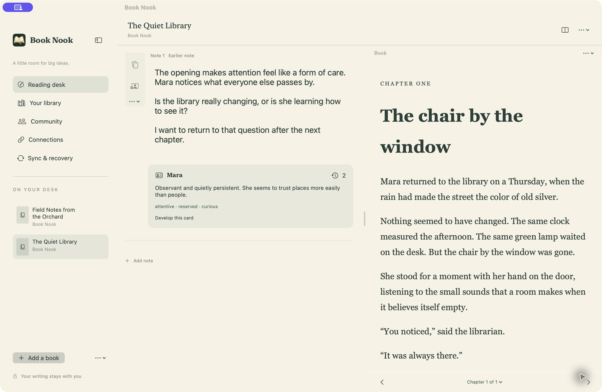
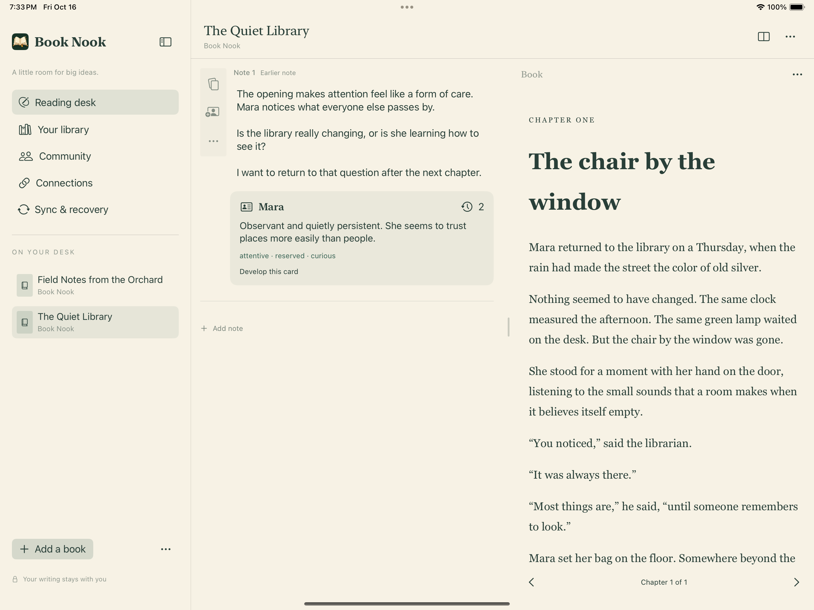

# Book Nook

A native reading notebook for macOS and iPad, backed by open Rust, Swift and WASM SDKs. Place the notebook on either side of the book to suit your writing hand. Both stay visible side by side; drag the divider to adjust their widths.

The implementation includes an offline reading desk, rich TextKit editing, EPUB/PDF reading and annotation, character interpretation history, imports, Castalia consent, approved encrypted device transfers, and Nostr social workflows. **It is not a qualified production release:** live Kindle/Audible account access, a real Castalia issuer, physical iPad input/accessibility, and distribution still require qualification. Unavailable integrations return explicit errors. See [delivery status](docs/DELIVERY.md), the [full-plan acceptance matrix](docs/PLAN-ACCEPTANCE.md), [validation](docs/VALIDATION.md), the [decision log](docs/DECISIONS.md), and the three-round [UX review](docs/UX-REVIEW.md).

**macOS — reading desk**



**iPad — reading desk**



Captured from the normal native Release app targets, version **0.1.0 (2026101603)**. The iPad capture uses an iPad Air 13-inch Simulator running iPadOS 18.6. Both use original sample books and notes in isolated local libraries. See [capture details](docs/screenshots/README.md).

## Run the native apps

Prerequisites: Rust, full Xcode, and XcodeGen. Scripts select Xcode through `DEVELOPER_DIR` without changing the global toolchain.

```sh
git clone https://github.com/bananawalnut/booknook.git
cd booknook
rustup target add aarch64-apple-ios-sim aarch64-apple-ios wasm32-unknown-unknown
bash scripts/build-apple.sh mac
open apps/apple/Build/mac/Build/Products/Debug/BookNookMac.app
```

For iPad, run `bash scripts/build-apple.sh ipad-sim`, then open `apps/apple/BookNook.xcodeproj` and choose `BookNookPad`. `ipad-device` compiles an unsigned physical-device variant; installation/distribution requires your own Apple signing team.

Start with **Add a book**, or import a Goodreads CSV or Kindle catalog from the sidebar’s **Import and backup** menu. Attach an accessible EPUB or PDF in the reader. Entries without readable content still support tracking and notebooks. In **Your library → Subjects**, add catalog topics for interest-based discovery; matching ignores case and duplicate topics. No DRM removal or unrestricted Kindle-content access is provided.

On iPad, tap a text note to type. Flip that note to its whiteboard to draw with a finger or Apple Pencil; use two fingers to pan and pinch to zoom. The light margin provides character cards and note options. The **Notebook on left/right** button remembers placement. Original handwriting, erased versions and reviewed on-device transcriptions remain independently recoverable; transcription never replaces ink or typed prose. See the [handwriting guide](docs/NOTEBOOK-HANDWRITING.md).

The native editor keeps typing, selection, IME composition and undo in TextKit. SQLite journals pending edits before asynchronous CRDT/history work, and replays the journal on reopen. Character cards attach to stable notebook blocks, reuse characters across reading passes, and retain every saved interpretation with available reading/listening observations. A chosen version can become a separate private note draft for reviewed sharing; later private edits cannot change that snapshot. EPUB/PDF highlights and portable ink stay anchored to the edition and content region. Ambiguous placement is shown as an unresolved marker.

## Configure connections inside Book Nook

**Connections** manages Castalia issuer pins, policy digest, credential endpoint, holder key, encrypted recovery import/unlock, Nostr relays, and the optional library companion. Secrets stay in device Keychain. Unlocking a key does not approve an operation: a native, expiring consent sheet binds each publication, pairing or sync batch to the exact reviewed record.

The [optional companion](services/library-companion/README.md) is a paired local service with Kindle XML/JSON import, explicit Kindle-for-Mac metadata snapshot import, and a bounded provider protocol. Raw SQLite snapshots stay on the selected local Mac: Book Nook permits their upload only to a literal loopback companion with proxy routing disabled; remote companions use normalized JSON/XML. Only supported ASIN/title/author fields are imported from cache snapshots, with no inferred progress or source time. Configure its address and pairing code inside Book Nook. An explicitly installed [optional Audible adapter](services/optional-audible-adapter/README.md) adds external-browser login completion, virtual-device registration, renewal, disconnect and source-position lookup. The app handles review and recovery; the companion's OS keyring holds source credentials. This separate AGPL-3.0-only component is never installed by normal app/SDK builds. Its protocol tests use synthetic responses; real account/MFA/Keychain/position accuracy remain unqualified. Connections also offers an [experimental US Kindle web import](docs/KINDLE-WEB-CONNECTOR.md): explicit Amazon sign-in in an isolated temporary session, bounded catalog pagination and atomic metadata-only import. Live sign-in, endpoint compatibility and purchase-history coverage remain unqualified. Selected catalog exports remain supported. Audible playback remains in Audible, and matching an edition never converts audio time to ebook text.

For a self-hosted authority provider, the [optional Castalia issuer](services/castalia-issuer/README.md) implements the app's existing endpoint with exact generic v2 signatures, explicitly supplied operator keys and deny-by-default holder/caller/action grants. Configure its endpoint, public pins, policy digest and access token inside Connections. It never creates production authority or substitutes another application's grants.

**Sync & recovery** pairs devices under the same Castalia reader using a random shared key stored in Keychain. Each private snapshot requires explicit approval, enters a durable encrypted outbox, and can be transferred as a file without a server. The receiver checks authority, recipient, source revision and asset integrity before merging. Conflicting personal fields remain available for review. “Exported” does not mean another device received it.

**Community** provides mutual friendships, a newest-first feed, selected publications, owner-managed shared lists, public/private groups, invitations, discussions, spoilers, blocking, moderation, discovery and explainable recommendations. Bind the Nostr transport key explicitly to Castalia, then connect to configured relays. Private delivery is encrypted separately for current recipients. Relay failures retain approved outbox entries. Recommendations exclude private notebook and private-group content.

## SDKs and replaceable providers

| Path | Purpose |
|---|---|
| `crates/core` | Portable records/commands, ontology validation, Yrs edits, immutable history, three-way reconciliation, imports, selectors, social protocol and Castalia verification |
| `crates/native` | SQLite/assets, recovery journal, custody, approved sync/outbox, native social orchestration, portable archive, CLI and UniFFI |
| `crates/wasm` | Core document, reconciliation and social contracts through wasm-bindgen |
| `crates/connectors` | Nostr relay/NIP-44, explicit transport identity bindings, companion and experimental Audible adapters |
| `apps/apple` | SwiftUI, TextKit, WKWebView, PDFKit, PencilKit, Keychain and native consent |
| `sdk/typescript` | Generated types and facades with atomic replaceable storage |
| `ontology` | Versioned artifacts, schemas, Zenith/Castalia v0.6.0 mapping, discovery and checksummed manifests |
| `services/library-companion` | Optional paired provider host; no Book Nook runtime server dependency |
| `services/castalia-issuer` | Optional owner-configured Castalia v2 issuer; no automatic identity or grant provisioning |
| `services/optional-audible-adapter` | Separately installed AGPL account/position process; no native/SDK dependency |
| `fixtures`, `tests` | Synthetic conformance, recovery, native editor/reader and interoperability evidence |

The reference apps use these public contracts. The Rust `Notebook<S>` engine accepts host-provided atomic storage, and the public SQLite adapter is the same implementation used by native commands. See the [SDK guide](docs/SDK.md) for integration and capability boundaries. Catalog, accessible content and progress are separate capabilities. A directory identity, a wallet key and permission to perform an action remain separate concepts. The future browser app can reuse the WASM SDK and companion; it is outside this native release.

## Validate and build SDKs

```sh
bash scripts/check.sh
bash scripts/test-reading.sh
bash scripts/test-recovery.sh
# Requires the native bridge from build-apple.sh mac:
bash scripts/test-ui-workflows.sh
python3 -m unittest discover -s tests/companion -v
bash scripts/test-sdk.sh
bash scripts/test-issuer.sh
```

Install `wasm-bindgen-cli` matching Cargo.lock (0.2.127) before building WASM. Use `bash scripts/build-wasm.sh web` for a browser package. Hosts supply atomic compare-and-save storage, independently trusted issuer policy and transport/custody adapters. The typed facade rejects unsafe JavaScript integers; raw JSON preserves Rust's integer range. WASM timestamp arguments use `bigint`.

The [deployment guide](docs/DEPLOYMENT.md#locally-consumable-sdk-packages) documents self-contained Rust crates, an installable npm archive, and a standalone Swift Package with three arm64 XCFramework slices. Package scripts test extracted or installed consumers before staging local deliverables; they never publish remotely.

The CLI accepts JSON commands on stdin with `booknook DESK_DIR command`; run it without arguments for usage. Local notebook saves never request a signature or network access. Portable exports include private data, original attached files, and separate social history; they exclude credentials and connection settings. Restore requires an empty desk. Device synchronization provides the merge path for an existing desk.

This implementation caps private state/portable JSON at 128 MiB and encrypted snapshot content at 64 MiB. Limits fail without silently truncating data or replacing existing exports. Chunked large-library transport and long-running history performance remain follow-up work.

For isolated visual QA, use `python3 scripts/seed-preview.py /path/to/empty-desk` and `BOOKNOOK_DATA_DIR`. An iPad override must be inside the app container. The normal app never seeds sample books automatically.

## Licensing and deployment

New reference-app Swift/reader files are MPL-2.0; new core/SDK code, schemas, fixtures and scripts are MIT OR Apache-2.0. Dependencies retain their licenses, including UniFFI's MPL-2.0. The separately installed Audible process and its upstream Audible dependency are AGPL-3.0-only, with an explicit inventory and notices; that exception is recorded in the decision log. Process separation does not by itself determine distribution obligations. The original compatible Castalia adapter uses established cryptographic libraries and upstream synthetic conformance data; it does not redistribute the unlicensed upstream presentation crate.

See [dependency inventory](docs/dependency-licenses.csv), [license boundaries](docs/LICENSING.md), [architecture](docs/ARCHITECTURE.md), [deployment](docs/DEPLOYMENT.md), and root license texts. CI definitions are provided; this task does not claim that a remote CI run, package publication, ontology deployment, signing, or app-store submission occurred.
