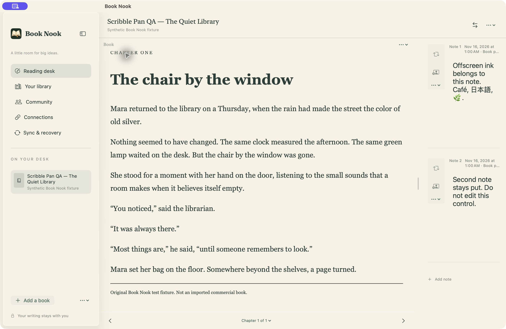
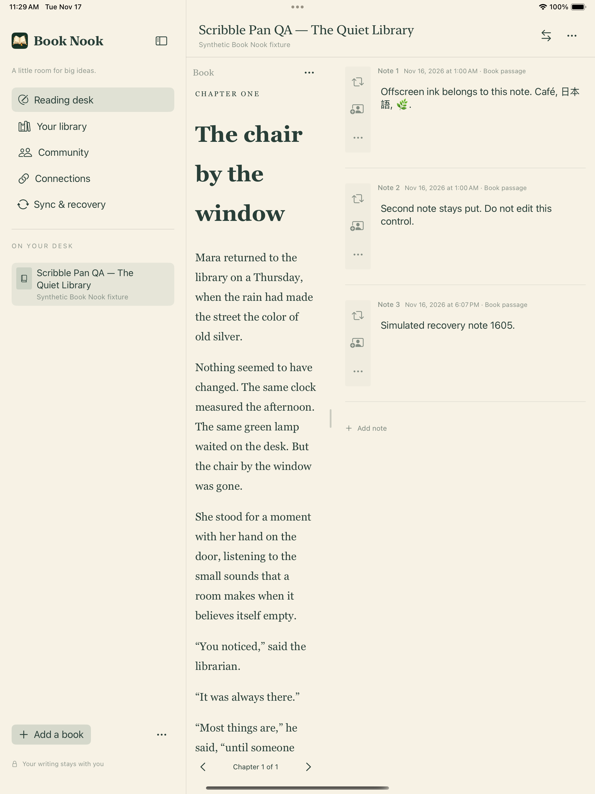

# Book Nook

A native reading notebook for macOS and iPad, backed by open Rust, Swift and WASM SDKs. The notes pane is called **Margin**. Place Margin on either side of the book to suit your writing hand. Both stay visible side by side; drag the divider to adjust their widths.

The implementation includes an offline reading desk, rich TextKit editing, EPUB, PDF, and legacy MOBI6 reading and annotation, character interpretation history, imports, Castalia consent, approved encrypted device transfers, Nostr social workflows, and reviewed RSS/Atom settings with offline publications. **It is not a qualified production release:** live Kindle/Audible/Castalia access, current physical input/accessibility, remote social/device sync and minimum-OS runtime checks remain open. Unavailable integrations return explicit errors. See [delivery status](docs/DELIVERY.md), the [full-plan acceptance matrix](docs/PLAN-ACCEPTANCE.md), [validation](docs/VALIDATION.md), the [decision log](docs/DECISIONS.md), the [UX review](docs/UX-REVIEW.md), and [DevGraph work tracking](docs/DEVGRAPH.md).

App preview 0.2.1 build **2026111722** verifies the selected file when importing books and catalogs. The iPadOS Files acceptance covered cancel, attach and reopen of an original PDF. All eight public downloads matched. The normal iPad app was updated in place and reopened with its library, Scribble and social state intact. [App preview](https://github.com/bananawalnut/booknook/releases/tag/v0.2.1-app-preview.20261117.22) · [Build evidence](docs/app-2026111722-public-preview-evidence.json)

App preview 0.2.1 build **2026111721** keeps the Mac sidebar readable as the desk narrows. All eight public downloads matched. The normal iPad update preserved the library, saved Scribble, social state, and observed orientation. A visible walkthrough of the packaged Mac app remains pending. [App preview](https://github.com/bananawalnut/booknook/releases/tag/v0.2.1-app-preview.20261117.21) · [Build evidence](docs/app-2026111721-public-preview-evidence.json)

App preview 0.2.1 build **2026111720** keeps approved transfers visible during a recovery Keychain error. All eight public downloads matched. The normal iPad update preserved the library, Scribble, social state and observed orientation. [App preview](https://github.com/bananawalnut/booknook/releases/tag/v0.2.1-app-preview.20261117.20) · [Build evidence](docs/app-2026111720-public-preview-evidence.json)

App preview 0.2.1 build **2026111719** checks current approval when writing to the chosen encrypted snapshot folder. The iPadOS Simulator Files picker passed cancel, save and retry, and the normal iPad app updated in place. All eight public downloads matched. [App preview](https://github.com/bananawalnut/booknook/releases/tag/v0.2.1-app-preview.20261117.19) · [Build evidence](docs/app-2026111719-public-preview-evidence.json)

App preview 0.2.1 build **2026111718** checks device access, Castalia trust and Outbox state before writing an approved encrypted snapshot. All eight public downloads matched. The in-place iPad update preserved the library, Scribble, social state and observed orientation. [App preview](https://github.com/bananawalnut/booknook/releases/tag/v0.2.1-app-preview.20261117.18) · [Build evidence](docs/app-2026111718-public-preview-evidence.json)

App preview 0.2.1 build **2026111717** preserves the roster version a reader reviewed and stops queued reply delivery after signed removal of its parent. All eight public downloads matched. The normal iPad update preserved the library, saved Scribble, social state and observed orientation. [App preview](https://github.com/bananawalnut/booknook/releases/tag/v0.2.1-app-preview.20261117.17) · [Build evidence](docs/app-2026111717-public-preview-evidence.json)

**[App preview 0.2.1, build 2026111716](https://github.com/bananawalnut/booknook/releases/tag/v0.2.1-app-preview.20261117.16)** keeps a saved group reply tied to its original draft and parent. If the parent becomes hidden or retracted during review, the reply stays private. All eight public app downloads matched. The iPad update preserved the library, saved Scribble and social state. [Build 1716 evidence](docs/app-2026111716-public-preview-evidence.json)

**[App preview 0.2.1, build 2026111715](https://github.com/bananawalnut/booknook/releases/tag/v0.2.1-app-preview.20261117.15)** keeps the same draft when you revise a saved Feed post or the opening post of a group thread. Approval applies to the exact version you reviewed. All eight public downloads matched their checksums. The normal iPad app reopened with its library, saved Scribble, and social state preserved. [Build 1715 evidence](docs/app-2026111715-public-preview-evidence.json)

**[App preview 0.2.1, build 2026111714](https://github.com/bananawalnut/booknook/releases/tag/v0.2.1-app-preview.20261117.14)** keeps the Feed and each reading group’s drafts separate. Review captures the selected destination and text, and edits made during approval stay in the editor. All eight public downloads matched their checksums. [Build 1714 evidence](docs/app-2026111714-public-preview-evidence.json)

**[App preview 0.2.1, build 2026111713](https://github.com/bananawalnut/booknook/releases/tag/v0.2.1-app-preview.20261117.13)**. Readers can preview verified discussions in open public groups before joining. Spoiler text is hidden by default, and joining is still required to post or reply. All eight public downloads matched their checksums. The normal iPad app updated in place with its library and Scribble preserved. [Build 1713 evidence](docs/app-2026111713-public-preview-evidence.json)

**[App preview 0.2.1, build 2026111712](https://github.com/bananawalnut/booknook/releases/tag/v0.2.1-app-preview.20261117.12)** can clear the matching local Audible connection after you confirm the registration was removed in Amazon’s device list. A newer replacement remains intact. Recovery requires the updated optional library companion and Audible adapter. Headless and synthetic loopback checks passed. Live Audible recovery and physical Keychain behavior remain unverified. All eight public downloads matched their checksums. The normal development-signed iPad app updated in place and reopened with its library, assets, saved finger Scribble, and observed orientation preserved. [Build 1712 evidence](docs/app-2026111712-public-preview-evidence.json)

**[App preview 0.2.1, build 2026111711](https://github.com/bananawalnut/booknook/releases/tag/v0.2.1-app-preview.20261117.11)** keeps Discover’s offline recommendations available when imported titles are long or contain control characters. Your library keeps the original titles. The optional self-hosted companion rejects a Kindle catalog that grows beyond the size limit during normalization and keeps the previous selection readable after restart. All eight public downloads matched their checksums. The normal development-signed iPad app updated in place and reopened with its library, assets, saved finger Scribble, and observed orientation preserved. [Build 1711 evidence](docs/app-2026111711-public-preview-evidence.json)

**[App preview 0.2.1, build 2026111710](https://github.com/bananawalnut/booknook/releases/tag/v0.2.1-app-preview.20261117.10)** preserves Margin order across offline edits and keeps the Mac insertion caret visible when resizing the notebook. The normal iPad update kept its existing library and saved finger Scribble. All eight public downloads matched their checksums. [Build 1710 evidence](docs/app-2026111710-public-preview-evidence.json)

**[App preview 0.2.1, build 2026111708](https://github.com/bananawalnut/booknook/releases/tag/v0.2.1-app-preview.20261117.8)** keeps a newly created reading pass tied to its original book, even if you switch desks while saving. The normal iPad update preserved the library and prior finger Scribble. All eight public downloads matched their checksums. [Build 1708 evidence](docs/app-2026111708-public-preview-evidence.json)

**[App preview 0.2.1, build 2026111707](https://github.com/bananawalnut/booknook/releases/tag/v0.2.1-app-preview.20261117.7)** gives short Character History labels their surrounding text and preserves the book order in reviewed shared-list edits. All eight public downloads matched their checksums. The locally signed 1707 update preserved prior finger Scribble on the normal iPad app. Concurrent offline Margin additions could appear in different orders after sync in that build. [Build 1707 evidence](docs/app-2026111707-public-preview-evidence.json)

**[App preview 0.2.1, build 2026111705](https://github.com/bananawalnut/booknook/releases/tag/v0.2.1-app-preview.20261117.5)** preserves the passage, reading pass, and available book and audio positions when you save a character-card revision. The normal iPad app updated to 1705 with its saved finger-drawn Scribble preserved. All eight public downloads matched their checksums. [Build 1705 evidence](docs/app-2026111705-public-preview-evidence.json)

**[App preview 0.2.1, build 2026111704](https://github.com/bananawalnut/booknook/releases/tag/v0.2.1-app-preview.20261117.4)** improves reading-position recovery in long EPUB and MOBI passages and adds replies in reading groups. All eight public downloads passed checksum verification. The normal iPad app updated in place and reopened with its library and previously saved finger-drawn Scribble preserved. [Build 1704 evidence](docs/app-2026111704-public-preview-evidence.json)

**[App preview 0.2.1, build 2026111703](https://github.com/bananawalnut/booknook/releases/tag/v0.2.1-app-preview.20261117.3)** adds **Book options → Attached editions** so readers can return to an earlier copy with its own reading position and highlights. Mac edition switching passed on the released app, all eight public downloads matched their checksums, and the normal iPad app launched after an update that preserved its library and orientation. [Build 1703 evidence](docs/app-2026111703-public-preview-evidence.json)

**[App preview 0.2.1, build 2026111702](https://github.com/bananawalnut/booknook/releases/tag/v0.2.1-app-preview.20261117.2)** shows why a saved EPUB highlight is unplaced and keeps its original quote available in Saved annotations. All three Apple archives and all eight public downloads passed verification. The normal iPad app was updated in place and launched with its library and orientation preserved. [Build 1702 evidence](docs/app-2026111702-public-preview-evidence.json)

The earlier [build 1701 preview](https://github.com/bananawalnut/booknook/releases/tag/v0.2.1-app-preview.20261117.1) added highlight rendering for older WebKit and an unplaced marker for PDF annotations. [Build 1701 evidence](docs/app-2026111701-public-preview-evidence.json)

The earlier [build 1607 preview](https://github.com/bananawalnut/booknook/releases/tag/v0.2.1-app-preview.20261116.7) added DRM-free legacy MOBI6 reading. The exact Mac app opened a synthetic MOBI, rendered Unicode text, and saved a Margin note. [Build 1607 evidence](docs/app-2026111607-public-preview-evidence.json)

The earlier [Mac build 2026111601 check](docs/mac-2026111601-evidence.json) confirmed that the long-note caret stayed visible through pane resizing on either side and that reopen preserved notes, styles, and character history.

The earlier [Mac 1503 long-note check](docs/mac-2026111503-longnote-evidence.json) preserves 360 paragraphs, formatting, history and normal reopen, but confirms a **caret visibility defect after pane resizing** in that published build. The [AppKit source repair](docs/mac-editor-reflow-evidence.json), including a right-edge shrink regression, is now included in the separately qualified local 1601 app. Historical 1503 [workspace](docs/mac-2026111503-evidence.json) and [native text/Undo/Redo](docs/mac-2026111503-keyboard-evidence.json) checks retain their own scope; published 1503 assets remain unchanged.

The **historical [app preview 1503](https://github.com/bananawalnut/booknook/releases/tag/v0.2.1-app-preview.20261116)** retains exact source `efec2dd`, its three qualified Release archives and all 11 verified public downloads / 37,729,663 bytes. [Its delivery evidence](docs/app-2026111503-public-preview-evidence.json) preserves the independent downloaded-bundle/mode/metadata/license comparisons and separate bounded runtime observations. It retains the known caret issue; the subsequent 1601 preview carries the repair.

Earlier local Mac Release **2026111502**, including native source `2a567f4`, adds explicit startup/retry and recovery states plus safer selected-file imports, retaining arrow controls and the **Margin**/**Scribble** names. Its 64 native tests, fresh production library, generated-interface comparison and local app inspection pass. Actual Mac restore, pane/Scribble switching and normal reopen preserve writing and history in an isolated Application Support store. A Documents-path QA override still waits in a directory-open syscall; the OS-level cause is unproven. The [November 16 workflow follow-up](docs/mac-2026111502-workflow-evidence.json) also verifies private review/list editing, an unrated sharing draft, setup guidance and normal reopen. [Scoped startup evidence](docs/startup-import-evidence.json) retains the unresolved path-dependent wait. These 1502 observations retain their original scope; the separate current 1601 result is recorded above.

Bounded Mac checks on build **1404** passed ASCII typing plus native Unicode paste, Undo/Redo, EPUB reading, character-card history/context, pane resizing/swapping, text-whiteboard-text switching and durable normal quit/reopen. Build **1405** separately showed the corrected labels and one successful later reopen. Its initial startup delayed in `chmod` before SQLite and resumed unaided; the cause remains unresolved. These checks extend the partial fourth UX round and do not qualify physical Pencil/keyboard/IME, accessibility or every workflow.

SDK preview **0.3.5** preserves the approved retry copy when an encrypted file write fails. Extracted Swift consumers passed transfer and reopen on macOS and iPadOS Simulator. All 15 public downloads matched. [SDK preview](https://github.com/bananawalnut/booknook/releases/tag/v0.3.5-sdk-preview.20261117) · [SDK evidence](docs/sdk-035-public-preview-evidence.json) · [Simulator evidence](docs/sdk-035-ipados-simulator-evidence.json)

SDK preview **0.3.4** adds an exact saved-action refresh. The extracted Swift consumer passed signed roster review on macOS and iPadOS Simulator, and all 15 public downloads matched. [SDK preview](https://github.com/bananawalnut/booknook/releases/tag/v0.3.4-sdk-preview.20261117) · [SDK evidence](docs/sdk-034-public-preview-evidence.json) · [Simulator evidence](docs/sdk-034-ipados-simulator-evidence.json)

**[SDK preview 0.3.3](https://github.com/bananawalnut/booknook/releases/tag/v0.3.3-sdk-preview.20261117)** applies exact-version review to reply drafts. Extracted Swift consumers passed signed reply tests on macOS and iPadOS Simulator. All 15 public SDK downloads matched. [SDK evidence](docs/sdk-033-public-preview-evidence.json) · [Simulator evidence](docs/sdk-033-ipados-simulator-evidence.json)

**[SDK preview 0.3.2](https://github.com/bananawalnut/booknook/releases/tag/v0.3.2-sdk-preview.20261117)** adds native replacement and exact-version approval for top-level post drafts. The packaged Swift test refused stale consent and reopened the approved edit. All 15 public downloads matched their checksums. [SDK evidence](docs/sdk-032-public-preview-evidence.json) · [Simulator evidence](docs/sdk-032-ipados-simulator-evidence.json)

**[SDK preview 0.3.1](https://github.com/bananawalnut/booknook/releases/tag/v0.3.1-sdk-preview.20261117)** exposes public-group previews and passed independent checks in Rust, Node, Chrome, macOS Swift, and an iPadOS 18.6 Simulator Swift consumer. All 15 public downloads matched their checksums. [SDK 0.3.1 evidence](docs/sdk-031-public-preview-evidence.json)

**[SDK preview 0.3.0](https://github.com/bananawalnut/booknook/releases/tag/v0.3.0-sdk-preview.20261117)** preserves offline Margin order and keeps competing orders available for review. The six Rust, npm, and Swift archives passed independent checks. All 15 public downloads matched their checksums. [SDK 0.3.0 evidence](docs/sdk-030-public-preview-evidence.json) · [Ontology 0.4.0 discovery](https://bananawalnut.github.io/booknook/ontology/discovery.json)

**[SDK preview 0.2.3](https://github.com/bananawalnut/booknook/releases/tag/v0.2.3-sdk-preview.20261117)** ships the versioned character-card context command in Rust, Swift, and WASM. The exact extracted Swift package preserved the save context and reopened the SQLite desk. The installed Node runtime and byte-identical browser WASM agreed with native SQLite. All 15 public downloads matched their checksums. [SDK 0.2.3 evidence](docs/sdk-023-public-preview-evidence.json)

**[SDK preview 0.2.2](https://github.com/bananawalnut/booknook/releases/tag/v0.2.2-sdk-preview.20261117)** provides four Rust crates, the npm SDK with Node and browser WASM, and the arm64 Swift SDK. An independent Rust consumer exported a legacy MOBI6 archive. Installed Node and real Chrome produced identical bytes, and the extracted Swift package restored and reopened the desk on arm64 macOS. All 17 public downloads matched their checksums. [SDK 0.2.2 evidence](docs/sdk-022-public-preview-evidence.json)

**[SDK preview 0.2.1](https://github.com/bananawalnut/booknook/releases/tag/v0.2.1-sdk-preview.20261116) is published** from exact source `efec2dd`: three fresh native slices, Node/web-target WASM outputs and six SDK archives pass actual consumers; extracted Rust tests report **303 passed, zero failed and five declared ignored**. All 38 exact-source CI steps and the separately audited 333-version offline receiving closure pass. All **14 actual unauthenticated downloads** match their hashes; actual downloaded Rust/npm/macOS Swift consumers pass under their separately audited offline receiving lock. [Qualification evidence](docs/sdk-021-qualification-evidence.json) preserves the full notice/inventory boundary and separates SDK delivery from app and full-MVP acceptance.

**[SDK preview 0.2.0](https://github.com/bananawalnut/booknook/releases/tag/v0.2.0-preview.20261114)** retains all six SDK archives and the original app build **2026111403**, from exact source a945df213150abe10e27cc6c5e92da130588bef8. [Audits](docs/security-dependency-audit-evidence.json), [CI](docs/security-020-ci-evidence.json), [native Release](docs/native-020-release-evidence.json) and [Rust/npm archive consumers](docs/security-020-packages-evidence.json) pass. All 17 unauthenticated downloads match the final manifest; the exact fresh receiving lock passes [separate audit/registry checks](docs/security-020-receiving-lock-evidence.json), and the actual public receiving consumers pass. Swift runtime execution is macOS arm64; other Apple slices are built/packaged/metadata-inspected. [Publication evidence](docs/security-020-public-preview-evidence.json) is separate from production-MVP acceptance. Old 0.1.0 remains withdrawn; held 0.1.1 candidates were never published. Maintenance notices remain visible. Rust Nostr types/transports change at 0.2.0; ontology, wire formats and saved data are unchanged. Live/device/runtime gates remain open in [delivery](docs/DELIVERY.md). The [public ontology](https://bananawalnut.github.io/booknook/ontology/discovery.json) remains independently qualified.

The [profile-file repair](docs/profile-import-file-evidence.json) originated at `995bf0df36f3a638fd185f704c19f41af4269cd6`: nonblocking open and validation of the opened regular-file descriptor reject blocking special files. Its old FIFO timeout, 14 fixed cases, native workflow and iPad typechecks remain separate source-bound evidence. The new build includes the fix; the immutable a945 app archives do not. SDK/signing contracts, wire/saved data and ontology are unchanged.

The earlier iPad acceptance check [updated the normal app in place to 0.2.1 (2026111601)](docs/ipad-2026111601-install-evidence.json) on the connected iPad. The existing local database was unchanged before launch, and no orientation commands were sent. [Normal launch passed](docs/ipad-2026111601-launch-evidence.json) after Apple developer-profile trust was confirmed. The existing empty library remained unchanged; hands-on iPad checks are still open.

**macOS — reading desk**



**iPad — reading desk**



The Mac window shows published build **2026111720**. The iPad Simulator image shows published build **2026111722**. Both use the same sample desk. [Capture details](docs/screenshots/README.md)

## Run the native apps

Prerequisites: Rust, full Xcode, and XcodeGen. Scripts select Xcode through `DEVELOPER_DIR` without changing the global toolchain.

```sh
git clone https://github.com/bananawalnut/booknook.git
cd booknook
rustup target add aarch64-apple-ios-sim aarch64-apple-ios wasm32-unknown-unknown
bash scripts/build-apple.sh mac
open apps/apple/Build/mac/Build/Products/Debug/BookNookMac.app
```

For iPad, run `bash scripts/build-apple.sh ipad-sim`, then open `apps/apple/BookNook.xcodeproj` and choose `BookNookPad`. `ipad-device` compiles an unsigned physical-device variant; installation/distribution requires your own Apple signing team.

Start with **Add a book**, or import a Goodreads CSV or Kindle catalog from the sidebar’s **Import and backup** menu. Attach an EPUB, PDF, or DRM-free legacy MOBI file in the reader. Book Nook reads supported legacy MOBI content from selected `.mobi` and `.azw` files as simplified text, preserving the original file for backups and paired transfers. Kindle catalog import is separate; it does not fetch book text. Protected content, AZW3/KF8 and KFX are unsupported. Entries without readable content still support tracking and notebooks. In **Your library → Subjects**, add catalog topics for interest-based discovery; matching ignores case and duplicate topics. No DRM removal or unrestricted Kindle-content access is provided.

On iPad, tap a text note in **Margin** to type. Flip that note to **Scribble** to draw with a finger or Apple Pencil; use two fingers to pan and pinch to zoom. The light control rail provides character cards and note options. The **Margin on left/right** arrow button remembers placement. Each note’s arrow button switches between its text and Scribble. Original handwriting, erased versions and reviewed on-device transcriptions remain independently recoverable; transcription never replaces ink or typed prose. See the [handwriting guide](docs/NOTEBOOK-HANDWRITING.md).

The native editor keeps typing, selection, IME composition and undo in TextKit. SQLite journals pending edits before asynchronous CRDT/history work, and replays the journal on reopen. Character cards attach to stable notebook blocks, reuse characters across reading passes, and retain every saved interpretation with available reading/listening observations. A chosen version can become a separate private note draft for reviewed sharing; later private edits cannot change that snapshot. EPUB/PDF highlights and portable ink stay anchored to the edition and content region. Ambiguous placement is shown as an unresolved marker.

## Configure connections inside Book Nook

**Connections** manages Castalia issuer pins, policy digest, credential endpoint, holder key, encrypted recovery import/unlock, Nostr relays, and the optional library companion. Secrets stay in device Keychain. Unlocking a key does not approve an operation: a native, expiring consent sheet binds each publication, pairing or sync batch to the exact reviewed record.

The [optional companion](services/library-companion/README.md) is a paired local service with Kindle XML/JSON import, explicit Kindle-for-Mac metadata snapshot import, and a bounded provider protocol. Raw SQLite snapshots stay on the selected local Mac: Book Nook permits their upload only to a literal loopback companion with proxy routing disabled; remote companions use normalized JSON/XML. Only supported ASIN/title/author fields are imported from cache snapshots, with no inferred progress or source time. Configure its address and pairing code inside Book Nook. An explicitly installed [optional Audible adapter](services/optional-audible-adapter/README.md) adds external-browser login completion, virtual-device registration, renewal, disconnect and source-position lookup. The app handles review and recovery; the companion's OS keyring holds source credentials. This separate AGPL-3.0-only component is never installed by normal app/SDK builds. Its protocol tests use synthetic responses; real account/MFA/Keychain/position accuracy remain unqualified. Connections also offers an [experimental US Kindle web import](docs/KINDLE-WEB-CONNECTOR.md): explicit Amazon sign-in in an isolated temporary session, bounded catalog pagination and atomic metadata-only import. Live sign-in, endpoint compatibility and purchase-history coverage remain unqualified. Selected catalog exports remain supported. Audible playback remains in Audible, and matching an edition never converts audio time to ebook text.

For a self-hosted authority provider, the [optional Castalia issuer](services/castalia-issuer/README.md) implements the app's existing endpoint with exact generic v2 signatures, explicitly supplied operator keys and deny-by-default holder/caller/action grants. Configure its endpoint, public pins, policy digest and access token inside Connections. It never creates production authority or substitutes another application's grants.

**Sync & recovery** pairs devices under the same Castalia reader using a random shared key stored in Keychain. Each private snapshot requires explicit approval, enters a durable encrypted outbox, and can be transferred as a file without a server. The receiver checks authority, recipient, source revision and asset integrity before merging. Conflicting personal fields remain available for review. “Exported” does not mean another device received it.

**Community** provides mutual friendships, a newest-first feed, selected publications, owner-managed shared lists, public/private groups, invitations, discussions, spoilers, blocking, moderation, discovery and explainable recommendations. Bind the Nostr transport key explicitly to Castalia, then connect to configured relays. Private delivery is encrypted separately for current recipients. Relay failures retain approved outbox entries. Recommendations exclude private notebook and private-group content.

## SDKs and replaceable providers

| Path | Purpose |
|---|---|
| `crates/core` | Portable records/commands, ontology validation, Yrs edits, immutable history, three-way reconciliation, imports, selectors, social protocol and Castalia verification |
| `crates/native` | SQLite/assets, recovery journal, custody, approved sync/outbox, native social orchestration, portable archive, CLI and UniFFI |
| `crates/wasm` | Core document, reconciliation and social contracts through wasm-bindgen |
| `crates/connectors` | Nostr relay/NIP-44, explicit transport identity bindings, companion and experimental Audible adapters |
| `apps/apple` | SwiftUI, TextKit, WKWebView, PDFKit, PencilKit, Keychain and native consent |
| `sdk/typescript` | Generated types and facades with atomic replaceable storage |
| `ontology` | Versioned artifacts, schemas, Zenith/Castalia v0.6.0 mapping, discovery and checksummed manifests |
| `services/library-companion` | Optional paired provider host; no Book Nook runtime server dependency |
| `services/castalia-issuer` | Optional owner-configured Castalia v2 issuer; no automatic identity or grant provisioning |
| `services/optional-audible-adapter` | Separately installed AGPL account/position process; no native/SDK dependency |
| `fixtures`, `tests` | Synthetic conformance, recovery, native editor/reader and interoperability evidence |

The reference apps use these public contracts. The Rust `Notebook<S>` engine accepts host-provided atomic storage, and the public SQLite adapter is the same implementation used by native commands. See the [SDK guide](docs/SDK.md) for integration and capability boundaries. Catalog, accessible content and progress are separate capabilities. A directory identity, a wallet key and permission to perform an action remain separate concepts. The future browser app can reuse the WASM SDK and companion; it is outside this native release.

## Validate and build SDKs

```sh
bash scripts/check.sh
bash scripts/test-reading.sh
bash scripts/test-recovery.sh
# Requires the native bridge from build-apple.sh mac:
bash scripts/test-ui-workflows.sh
python3 -m unittest discover -s tests/companion -v
bash scripts/test-sdk.sh
bash scripts/test-issuer.sh
```

Install `wasm-bindgen-cli` matching Cargo.lock (0.2.127) before building WASM. Use `bash scripts/build-wasm.sh web` for a browser package. Hosts supply atomic compare-and-save storage, independently trusted issuer policy and transport/custody adapters. The typed facade rejects unsafe JavaScript integers; raw JSON preserves Rust's integer range. WASM timestamp arguments use `bigint`.

The [deployment guide](docs/DEPLOYMENT.md#locally-consumable-sdk-packages) documents self-contained Rust crates, an installable npm archive, and a standalone Swift Package with three arm64 XCFramework slices. Package scripts test extracted or installed consumers before staging local deliverables; they never publish remotely.

The CLI accepts JSON commands on stdin with `booknook DESK_DIR command`; run it without arguments for usage. Local notebook saves never request a signature or network access. Portable exports include private data, original attached files, and separate social history; they exclude credentials and connection settings. Restore requires an empty desk. Device synchronization provides the merge path for an existing desk.

This implementation caps private state/portable JSON at 128 MiB and encrypted snapshot content at 64 MiB. Limits fail without silently truncating data or replacing existing exports. Chunked large-library transport and long-running history performance remain follow-up work.

For isolated visual QA, use `python3 scripts/seed-preview.py /path/to/empty-desk` and `BOOKNOOK_DATA_DIR`. An iPad override must be inside the app container. The normal app never seeds sample books automatically.

## Licensing and deployment

New reference-app Swift/reader files are MPL-2.0; new core/SDK code, schemas, fixtures and scripts are MIT OR Apache-2.0. Dependencies retain their licenses, including UniFFI's MPL-2.0. The separately installed Audible process and its upstream Audible dependency are AGPL-3.0-only, with an explicit inventory and notices; that exception is recorded in the decision log. Process separation does not by itself determine distribution obligations. The original compatible Castalia adapter uses established cryptographic libraries and upstream synthetic conformance data; it does not redistribute the unlicensed upstream presentation crate.

See [dependency inventory](docs/dependency-licenses.csv), [license boundaries](docs/LICENSING.md), [architecture](docs/ARCHITECTURE.md), [deployment](docs/DEPLOYMENT.md), and root license texts. Source is public on GitHub and [CI runs there](https://github.com/bananawalnut/booknook/actions/workflows/check.yml); consult exact-revision results rather than inferring success from local evidence. SDK 0.2.1 archive downloads and actual downloaded consumers pass; registry publication and optional Apple distribution remain separate; the [static ontology host](docs/ontology-pages-public-evidence.json) is independently qualified.

Portable Castaway feed settings and RSS/Atom discovery are [implemented separately from verified social activity](docs/FEEDS.md). The SDK provides reviewed settings, bounded normalization, isolated public HTTPS sources and a [native/Swift offline cache](docs/FEED-CACHE.md). Connections → Publications supports reviewed public-URL addition and raw settings import/export; Discover shows inert external cards after explicit local activation/refresh. The original 0.2.0 native workflows retain their [scoped qualification](docs/native-020-release-evidence.json); the refreshed app build has [separate build, archive, public-download and bounded Mac evidence](docs/app-2026111405-public-preview-evidence.json). Remaining hands-on workflows, accessibility and production cross-client handoff remain gated.
