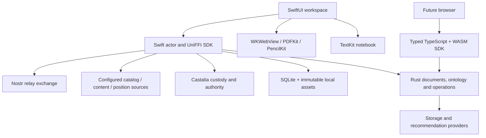

# Architecture and contracts

The Rust core accepts typed commands against a portable state. Platform hosts supply storage and transport. Native apps use UniFFI and SQLite; WASM uses the same command implementation with host-provided atomic storage. No auth, network, editor event or file operation runs synchronously on the SwiftUI main actor except immediate presentation work and small configuration operations.

## Persistence and editing

SQLite stores a versioned state snapshot under WAL and `synchronous=FULL`. A compare-and-save revision predicate prevents independent handles from losing committed changes. Failed operations modify a staged state and do not commit partially. This first store uses a whole-state row; it is intentionally simple and needs profiling and indexed projections before very large libraries/history sets.

TextKit owns immediate keystrokes, marked-text composition and undo. Committed changes enter a serial asynchronous save queue. Yrs applies scalar-aligned edits using UTF-16 offsets, matching native text and DOM ranges. Bold, italic and underline are portable Yrs attributes. Serialized text/style projections are validated against the stored CRDT update. A save failure keeps the pending edit and exposes a retry; “Saved locally” only follows acknowledged persistence. A process killed before an edit reaches Rust can still lose that unacknowledged edit.

Each notebook block has a stable ID. Character cards reference the block and a stable literary character. Immutable card versions name parents, reader, time, reading pass, book/audio positions and interpretation fields. Multiple heads remain visible; the conflict editor requires an explicit starting version and only acknowledges the parents visible when it opened. `history::merge_card` topologically merges versions and rejects conflicting reuse of a version ID. The native synchronization coordinator merges text and character history and keeps unresolved personal-field conflicts available for review.

Reading sessions have explicit Start/Finish operations, checked reading-pass references and time intervals, and survive reopening. Separate offline sessions may coexist after reconciliation; the app shows each active session rather than inferring an end time. Place, Theme, Event, and Concept records have public creation commands. Character cards remain the first specialized component, and no literary entity becomes a Rolodex directory identity.

Local reader IDs are attribution only. They do not impersonate Castalia identities. A work, edition, provider identifier and readable asset are separate records. Attaching a distinct file creates a distinct edition record instead of assuming it matches a catalog edition. Exact duplicate assets are content-addressed. Imports match exact provider IDs; cross-provider work/edition reconciliation is deliberately not guessed from titles.

## Reading and annotations

EPUB import checks archive size, entry count, expansion limits, duplicate paths, traversal, symlinks, container/package/spine references and unsupported encryption. EPUB fonts with obfuscation are also rejected at present. The reader runs with book JavaScript disabled, a nonpersistent WebKit store, local read scope and a compiled rule blocking nonlocal resources before loading content. The bundled bridge handles selection and layout measurement; book content does not get privileged storage APIs.

Text anchors contain edition, resource, exact quote, prefix and suffix. Multiple matching passages return `ambiguous`; zero matches return `missing`. UTF-16 offsets are used at the native/DOM boundary. Highlights are recalculated from anchored passages. Native ink and portable strokes are both stored. Content-relative transforms account for scrolling and zoom; changed text layout leaves original context in an annotation marker rather than guessing. PDFKit authors page-relative highlights and ink without modifying source bytes. Portable rendering and geometry tests cover these paths; physical Pencil routing, rotation, reflow and interrupted input remain hardware qualification gates.

Known EPUB links and fragments pass through the native chapter coordinator, preserving the displayed resource in subsequent selections and observations. External links, escaping paths and unsupported non-spine resources remain blocked with visible feedback. Cross-chapter annotations return to their source passage; they are not declared misplaced merely because another chapter is open.

## Identity and publication

Book Nook uses Castalia identity without a separate Book Nook membership scope. Shared Castalia public authority profiles configure native v2 issuers through explicit review; shared provider-connection descriptors identify adapter-managed credentials separately from signing authority. Book Nook stores domain records and optional source connection references. The current adapter uses secure local storage; a wallet-managed transport remains an extension point. See [the ownership, onboarding and portability contract](CASTALIA-CONNECTIONS.md).

The v2 receipt verifier independently checks the issuer pin, caller, audience, holder, policy digest, canonical request bytes, exact payload digest, version, disclosure, nonces, validity bounds and both Ed25519 signatures. It rejects duplicate keys, unknown fields, unsafe disclosure controls, noncanonical hex/base64 and expired/mismatched receipts. No new Castalia signature protocol was invented. Native secure storage holds encrypted recovery material. An original compatible custody adapter, verified against an upstream synthetic vector, decrypts temporarily and signs only the exact approved operation. Candidate recovery imports validate in isolated custody before replacing a saved file. Real issuer provisioning and physical secure-storage behavior remain unqualified.

The optional reference issuer is a separate, operator-configured HTTP/native process. It reloads explicit holder/caller/action grants, checks the current canonical policy digest, and issues short-lived generic Castalia v2 credentials. It receives a payload digest with an explicit holder-supplied/no-payload-inspection disclosure; custody and receivers still verify the actual content and current permissions. It never creates production trust or substitutes Devgraph grants.

Publishing selected content creates an independent `ShareDraft` containing only the supplied excerpt. It has no notebook ID, CRDT state or private history. A chosen character version can create an editable selected-note draft containing that interpretation’s readable fields and passage text; private identifiers, source locations and other versions are excluded. It is a durable snapshot, independent of later private edits, and still requires explicit publication review. A reviewed batch binds content digest, recipients and revision. `sync::seal` requires a verified `sync.send` approval and encrypts with XChaCha20-Poly1305 using the batch as authenticated associated data. Native pairing, durable outbox/replay consumption, encrypted file transfer and full-state reconciliation are implemented as described below; they are not an automatic background sync service.

Nostr is an optional relay transport, not the permission model. A Castalia-authorized `nostr.bind` record binds its separate Schnorr public key. The adapter validates event ID/signature, binding, envelope and v2 publication receipt before accepting activity. Current membership and group epoch are rechecked. Historical publication receipts are checked at the signed publication timestamp while current operator trust and group membership remain mandatory. Kind 30078 uses distinct `booknook:social:<id>:public` identifiers for public records and opaque digests for per-recipient NIP-44 envelopes. Private delivery includes the author's own bound transport key for other devices and explicitly retains its recipient tag.

Private membership changes carry separately signed admission proofs when peers did not receive each other’s invitations. Each invitee explicitly consents to proof disclosure to current/future members. Recipients verify original authority, group, epoch, expiry and replay rules without receiving private discussion history.

Chronological feed/deduplication, mutual friendships, reviews/ratings/updates, shared lists, public/private groups, discussion, spoilers, blocking and moderation are implemented through the portable social contract and native interface. Recommendations use catalog inputs and independently verified public friend evidence; the input has no private-writing field. Actual network and account qualification must be read from the validation record rather than inferred from protocol tests or compiled UI.

## Optional listening source

The paired companion can invoke the separately installed AGPL Audible adapter as a bounded process. The adapter uses an external-browser PKCE login, explicit virtual-device registration consent, and OS keyring storage without plaintext fallback. Native Connections persists only its pending login in Keychain and offers completion, cancellation, renewal, disconnect and guarded uncertainty recovery. Position normalization preserves upstream observation time and skips missing evidence. Catalog title/author metadata is optional and does not invent ebook identifiers.

The Rust matcher ranks exact namespaced IDs and Unicode-normalized title/author evidence, shows conflicting editions/languages and requires explicit selection. A confirmed association never maps audio time to ebook text. Playback remains in Audible. The source is non-public and remains unqualified with real accounts.

## Ontology and versioning

The 0.1.0 release has a stable `urn:booknook:ontology:` namespace and a relative discovery manifest, so no unowned domain or live hosting is assumed. Its schemas are generated from Rust, then used to generate the TypeScript data types. Both apps bundle the release for offline use. The release also contains reusable positive/negative `conformance.json` vectors for state, commands, Unicode/history, time/reference invariants and Rolodex compatibility. They are included in the artifact checksum manifest and tested against the actual implementations. Publication can use an independent static host; no public deployment has occurred.

The mapping pins the inspected Zenith ontology 0.6.0 bundle digest. Rolodex `Entity`, `Person`, `Agent`, `Organization` and `Actor` alias meanings are preserved. Literary `Character` is not a Rolodex `Person`. Directory attribution is not operational authority. The mapping records the compatibility contract; it is not a claim that the full upstream ontology or a Rolodex runtime has been vendored or implemented.

References: [TextKit](https://developer.apple.com/documentation/UIKit/textkit), [PencilKit](https://developer.apple.com/documentation/pencilkit), [UniFFI](https://mozilla.github.io/uniffi-rs/latest/), [Yrs](https://github.com/y-crdt/y-crdt), [W3C annotations](https://www.w3.org/TR/annotation-model/), [Nostr base protocol](https://github.com/nostr-protocol/nips/blob/master/01.md).

## Durable editor and replica boundaries

Native editing writes the latest text/style intent into SQLite before the heavier Yrs/history update. A mounted editor owns a sequential local CRDT branch, initialized from the state actually displayed. It never derives a stale full-text edit from a freshly synchronized document. A single transaction merges the branch, advances its journal sequence, writes history, and clears the exact acknowledged intent. Opening a desk replays pending work; navigation and export drain committed native composition first.

Private device synchronization is a replaceable encrypted-file adapter over the public batch and reconciliation contracts. Pairing is configured in the native app, approved using `device.enroll`, and limited to devices belonging to the same configured Castalia reader. Secure storage holds the 32-byte pair key; the database holds only its digest. `sync.send` approves an immutable snapshot and recipient. Approval, nonce consumption and encrypted outbox insertion commit together before file export. Imports validate current independent issuer pins, historical approval, recipient, source, content digest and asset checksums before the state transaction. Reordered older snapshots and changed content at the same source revision are rejected. Character history keeps branches, Yrs merges text, and conflicting mutable fields are retained for explicit review.

Social state has its own schema and SQLite transaction boundary. It contains only explicitly selected publications, requests, membership changes, public discovery records and approved delivery state. Private group posts are separately encrypted to each current member with NIP-44; no group identifier or Castalia actor is placed in their outer relay tags. Castalia bindings are discovered only under configured issuer trust, and minimum accepted transport-key versions remain locally pinned. A signature from Nostr does not create operational authority.

The public `identity` module supplies a replaceable `CastaliaIdentityProvider` and descriptive Rolodex references for Entity, Person, Agent and Organization. `Actor` decodes as the compatibility alias of Entity. Literary characters are excluded from those directory kinds. Attribution links preserve source evidence and never create authorization receipts. A general Rolodex directory service/UI is not bundled; hosts can implement that provider against their own source.

## Provider-backed SDK execution

`booknook_core::providers::Notebook<S>` accepts any implementation of the public `NotebookStorage` contract. It checks advertised availability/capabilities, validates loaded state, applies a portable command, and returns success only after atomic compare-and-save. Failed storage or competing writes leave the caller without a false successful projection. The native `SqliteNotebookStorage` is a public implementation of that same port; the reference app's command path consumes this engine. Host-store and real independent-SQLite-handle tests exercise failure and conflict behavior. TypeScript's `BookNook.open(core, storage)` provides the corresponding asynchronous host adapter.

`CatalogRecommendations` implements the recommendation port used by the native fallback. Other source/identity traits describe replaceable provider boundaries, while the reference native app supplies concrete contained-reader, companion, custody and relay adapters. The reference `Desk` remains the SQLite/assets/journal composition; replacing that whole native persistence composition requires a host integration, not changing a settings string. Capability advertisements never grant authority or imply that a catalog includes accessible content.
