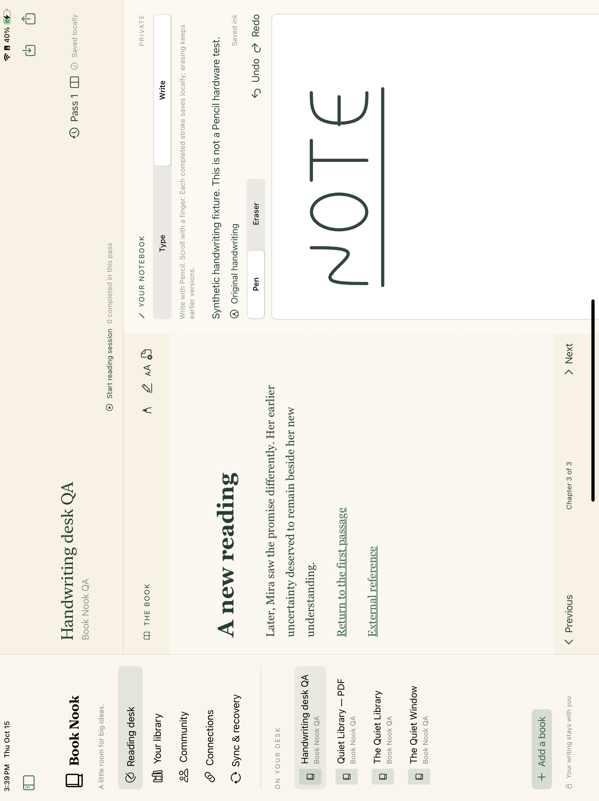

# Writing by hand

The notebook is a sequence of separate notes. A note normally shows only its typed text and reviewed transcripts. Tap its text to write; **Add note** starts another note below it. A subtle margin contains a direct **Add character card** action, the note’s options, and **Flip note to whiteboard**. Flipping changes only that note’s face: its text, order, character cards and creation context remain attached. Use **Show note text** to return. There is no global Type/Write picker, and attaching a keyboard does not switch faces.

On iPad, the whiteboard accepts finger drawing and Apple Pencil immediately. Draw with one finger, pan within it with two fingers and pinch to zoom; the margin and space between notes still scroll the notebook. The drawing area grows as you approach its edges instead of scaling all writing to fit a fixed page. Existing points keep their absolute coordinates when the board grows left, right, up or down. It is a viewport-sized canvas with a finite world-coordinate safety limit of ±1,000,000 units, not an unlimited allocation. At that limit, use another note. Pen, Eraser, ink Undo/Redo, zoom and Return to origin are available in that note’s options menu. Drawing pauses ancestor notebook scrolling during finger or Pencil contact; the book remains independently scrollable.

Each note shows a quiet creation time and available book/audio location. New empty placeholders do not acquire an invented opening-time timestamp. Older notes retain an explicitly historical or unknown origin rather than being relabeled with today’s reading position. Book passages and audio times remain separate source observations. Flipping, panning and zooming do not create ink versions or change the note’s origin.

Use the **Notebook on left/right** button in the desk header to swap sides. Drag the divider to resize the panes; both remain visible, including in narrow layouts. Side and completed width changes stay on this device. The same native views remain mounted across swaps. The divider also supports accessibility adjustment and **Equal pane widths**. A note’s text editor and drawing board also stay mounted across its flip, with separate undo histories; hidden prose cannot keep receiving keyboard input.

Completed strokes and erasures save locally without signing. Pen, Eraser, Undo and Redo affect the ink canvas. **Ink history** retains earlier versions, including erased drawings. Continuing from an earlier version creates a branch; other versions remain recoverable. Conflicting incoming versions are retained and shown for review. Completed captures first enter a private recovery journal on this device, then the notebook is updated. If a final save fails, the original remains in local recovery and the desk offers Retry. Keep the app open until the initial recovery write is acknowledged. Journaled originals are recovered after reopening; only finalized notebook records enter portable backups.

**Transcribe…** opens a separate review sheet for an exact saved ink version. **Recognize on this device** uses Apple's Vision text recognition, or you can enter text yourself. Review and correct the result, then choose **Save transcript**. The result appears on the note’s text face, linked to its original handwriting version. It never overwrites ink, existing transcripts or typed prose. **Stop recognition** leaves the review sheet open for manual transcription; **Cancel** closes it. A cancelled request cannot replace the draft if it returns late. Once a draft contains text, recognition cannot replace it. A transcript save must finish or report its error before dismissal. No handwriting is uploaded for recognition. Recognition quality for cursive, symbols, layouts and languages still needs real handwriting evaluation. See [Apple’s on-device recognition guidance](https://developer.apple.com/videos/play/wwdc2019/234/) and [revision 3 language guidance](https://developer.apple.com/videos/play/wwdc2022/10024/).

The macOS whiteboard displays portable strokes with mouse/trackpad pan and zoom, ink history and transcripts; drawing is read-only there, while Pencil capture is on iPad. Original PencilKit drawing data and portable strokes travel together in export and approved encrypted synchronization. Private notebook ink and transcripts remain excluded from recommendations and implicit sharing.

## Recovering markup on the book

Book markup uses edition-specific anchors, separately from each note’s whiteboard. The desk retains a completed reader stroke while resolving its original passage or saving it. If resolution or saving fails, the reader shows the retained drawing and a retry action. It does not move that ink to a newly selected chapter or reading pass. Reader text size is remembered on this device.

When exact placement cannot be recovered, **Save as unplaced markup** explicitly saves the original native drawing and portable strokes with their captured edition/resource or PDF page. The saved list shows a preview and its original context; opening its chapter does not assert a precise over-text placement. The private recovery journal retains the original pass, edition, resource/page context, capture order, native bytes and portable strokes while anchoring is unresolved. After local recovery acknowledgment, ordinary book/pass navigation and side swapping remain available. Reopened unresolved captures can be reviewed, retried or saved as unplaced markup. They are not included in portable backups until finalized. Keep the app open until the initial recovery write is acknowledged; an interrupted, unacknowledged stroke and device power loss are not qualified by the recovery test.

The EPUB locator uses the existing `Provider` location with provider `booknook.reader.unplaced`, source ID equal to the captured asset fingerprint, and bounded `booknook.reader-unplaced.v1` JSON containing edition, resource, asset/content/layout fingerprints, document URL and coordinate-space context. It contains no invented quotation. PDF recovery retains a page locator. Both forms omit `ink_geometry`; they must not be treated as located text overlays.

## Private recovery boundary

The app keeps a versioned, bounded per-capture journal beside its local desk. Complete records are written with private file permissions and synchronized before acknowledgment. Stable IDs and original-parent/capture dependencies support retry without duplicating or reordering history. A final native save must succeed before its journal record is removed. Complete temporary records interrupted before publication can be recovered; partial, conflicting or unsupported records remain untouched and produce a visible error. These private envelopes are not a new public ontology or portable-export format.

The delivered `scripts/test-ink-recovery.py` kills an actual child process after four original captures reach the file and directory durability barriers: two notebook versions, including erasure, and two reader captures while an anchor is blocked. Reopen, original-byte/context/history preservation, explicit unplaced finalization and portable export pass. This is process-termination acceptance after acknowledgment, not a power-loss or physical Pencil guarantee. The recognition-controller regression also passes cancelled late-result rejection and exact-source reviewed-transcript persistence.

## Public data and compatibility

A block's optional `ink` record has schema `booknook.notebook-ink.v1`. Immutable versions contain parent IDs, reader/time/reading-pass context, source positions captured when the drawing gesture begins, logical canvas dimensions, portable strokes and optional native drawing bytes. New whiteboard versions additionally carry `canvas_space` with a world origin; dimensions describe its rectangle. Raw portable points and native drawing coordinates remain absolute. Legacy fixed-page versions retain their existing zero origin and dimensions, and remain selectable in history. Transcriptions reference an exact version and preserve their own author, time, text and method. Stable operation IDs support retry without duplicate snapshots.

Typed legacy archives remain `booknook.archive.v1` with ontology 0.1.0, and existing fixed-page ink remains `booknook.archive.v2` with ontology 0.2.0. Using the new note metadata or whiteboard coordinate space promotes state to `booknook.archive.v3` with ontology 0.3.0. Updated SDKs read all three; earlier strict readers reject the new version rather than discard unknown context or coordinate metadata. The outer `booknook.portable-export.v1` envelope remains, with a separately published portable schema edition v2. Previously issued ontology and schema artifacts remain unchanged.

The native and SDK acceptance record is linked from [validation](VALIDATION.md). The three bounded physical iPad checks below belong to the preserved handwriting baseline, not the current per-note text/whiteboard source or packages. They passed: rendering, Write controls, side swapping, finger scrolling, ink history, rotation, saved preferences, and on-device recognition/review/save/reopen using synthetic ink. Independent storage comparison preserved the original ink and all existing notebooks. See the [physical evidence](physical-notebook-handwriting-evidence.json). That baseline did not exercise the compact switch; the later historical reader-context result covers only its stated path and app reopen, without a new device database comparison. Physical Pencil input, palm rejection and recognition of your own handwriting still need hardware and hands-on evaluation.

## Physical iPad examples

These historical screenshots use the separate synthetic acceptance notebook and predate the reader-context recovery changes. They show the notebook on the right, [the two-pane portrait layout](evidence/notebook-handwriting-portrait-ipad.png), and [the separately saved transcript after reopening](evidence/notebook-transcript-reopen-ipad.png). The transcript screenshot is scrolled below the drawing's letters; storage comparison confirms that both original ink versions remain unchanged.

